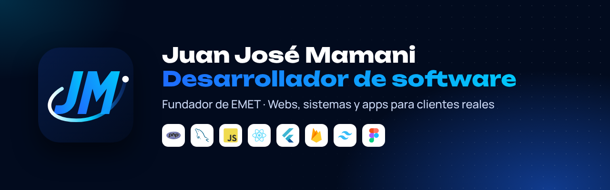

  

  
  
  
  

### 👋 Hola, soy Juan José

Desarrollo **páginas web, sistemas y apps** para empresas e instituciones de Bolivia, desde la idea y la base de datos hasta tenerlos en línea y en uso. Soy fundador de **[EMET](https://jose011011.github.io/emet/)**, mi agencia de software, y estudio Informática en la **UMSA**.

- 💼 **Disponible** para proyectos, trabajos y prácticas
- 🧩 Sistemas completos: base de datos, servidor, paneles y diseño
- 📱 Apps móviles con Flutter y Firebase
- 📊 Sistemas en Excel con VBA para oficinas que ya usan Excel

### 🤝 Clientes

| Cliente | Qué hice | Tecnologías | Ver |
|---|---|---|---|
| **TECDEPRO** | Portal de cursos y sistema interno para la fundación | PHP · MySQL · MVC | [tecdepro.org](https://tecdepro.org) · [presentación](https://github.com/jose011011/tecdepro) |
| **NAABOL** | Sistema de registro digital de correspondencia | Excel · VBA | [presentación](https://github.com/jose011011/naabol) |
| **FixGeo** | Plataforma de técnicos con GPS en vivo, chat y pagos por QR | PHP · MySQL · API REST | [fixgeo.net](https://fixgeo.net) |
| **Magnus** | Sitio web de una agencia de despacho aduanero | HTML · Tailwind · JS | [sitio](https://jose011011.github.io/MagnusV2/) |

### 🚀 Proyectos propios

| Proyecto | Descripción | Tecnologías |
|---|---|---|
| [**App de streaming**](https://github.com/jose011011/app-streaming) | App con cuentas, planes VIP, chat de soporte y recomendaciones con IA. Tiene usuarios activos. | Firebase · Android |
| [**HabitGo**](https://github.com/jose011011/habitgo) | App de hábitos con rachas, cronómetro y grupos | Flutter · Dart |
| [**Delicias en Línea**](https://github.com/jose011011/PEDIDOSYA-) | Tienda de comida con carrito y cupones (en equipo) | HTML · Tailwind · JS |

👉 Mira todos mis proyectos con capturas en **[jose011011.github.io](https://jose011011.github.io)**

### 🛠️ Herramientas

  

### 📊 Actividad

  
  

